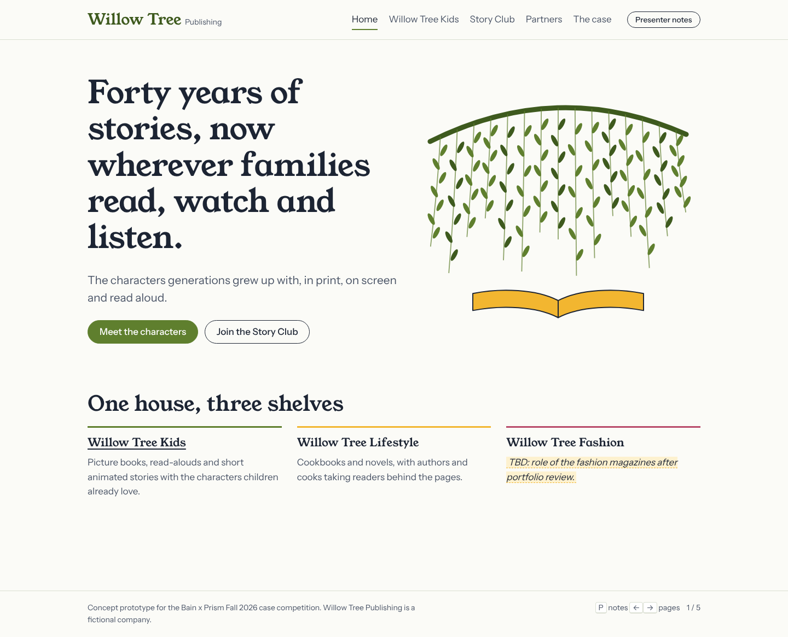

# Willow Tree Publishing: case demo

Working repository for the Bain x Prism Fall 2026 case competition.

- **[AGENDA.md](AGENDA.md)** is the living record of project aims, evidence, the draft recommendation, open decisions and a changelog. Update it whenever the plan changes.
- **[DESIGN.md](DESIGN.md)** documents the visual design system (colours, type, layout, components) so it can be reproduced in slides or other pages. Screenshots are in [docs/screenshots](docs/screenshots/).
- **The demo website** (everything else) is a visual aid and technical demo for the presentation.



Screenshots in `docs/screenshots/` show the first version of the site; the November 2026 update added the Lifestyle, Shop and Credits pages and more content throughout.

## Running the site

No build step or dependencies. Either open `index.html` in a browser, or serve the folder:

```
python3 -m http.server 8000
```

then visit http://localhost:8000. To publish, enable GitHub Pages on the `main` branch (Settings → Pages); the site will be at `https://lnorberg.github.io/WebsiteforCase/`.

## Presenting

| Key | Action |
|---|---|
| P | Toggle presenter notes (shows which strategy pillar each section illustrates) |
| ← / → | Previous / next page (Home, Kids, Lifestyle, Shop, Story Club, Partners, The case) |

The read-along on the Willow Tree Kids page uses the browser's built-in speech synthesis. Chrome and Edge give the best voices and word highlighting; test on the presenting machine before the day.

## Editing content

All copy lives in `assets/js/content.js`. Pages are lists of sections, and each section names a component `type`. Shared data sits at the top of the file: `team` (footer names), `photos` (with credits), `characters`, `genres`, `catalog` (shop books) and `partners` (placeholder logos).

| Type | Use |
|---|---|
| `hero` | Large opening headline, text, buttons, willow illustration |
| `text` | Short lead paragraph |
| `features` | Grid of titled items, optionally linked |
| `cards` | Photo cards where the whole card is a link |
| `characters` | Book spines on a shelf; spines with `href` are links |
| `cast` | Character cards from `characters`; `compact: true` for a row of portraits |
| `readAlong` | Narrated story with word highlighting |
| `media` | Video, audio or YouTube embed; with no `src`, a `poster` photo stands in |
| `videos` | Grid of episode thumbnails |
| `spotlight` | Photo or art beside text, with optional host, points and buttons |
| `banner` | Promotional band with its own title, text, buttons and visual |
| `books` | Books from `catalog`; `filters: true` adds genre chips, `link` makes covers links |
| `tiers` | Subscription or pricing options; `billing: true` adds a monthly/yearly toggle |
| `steps` | Numbered sequence |
| `timeline` | Years in order |
| `stats` | Figures with a source line |
| `logos` | Placeholder partner logos from `partners` |
| `faq` | Expandable questions |
| `subnav` | In-page chips linking to sections |
| `credits` | Team names and photo credits (Credits page) |
| `placeholder` | Reserved space for content to come |

Any section can carry `heading`, `intro`, `more: { label, href }`, `note: { pillar, text }` for presenter mode and `draft: true` to outline it as unfinished. Text starting with `TBD` is highlighted so gaps are visible.

Links can point inside a page: `#/kids/pilot` scrolls to the section with `id: "pilot"`, and `#/shop/cookbooks` (any genre or character id) opens the shop filtered. Buttons in `actions` without an `href` take a `demo` message and show it as a toast.

To add a page, add an entry to `nav` and a matching key in `pages`. Pages in `pages` but not in `nav` (like `credits`) are reachable by link only.

### Photos

Photos are hotlinked from Wikimedia Commons, with credits on the Credits page. If a photo can't load, a labelled placeholder takes its place, so the site still works offline. For a fully offline demo, download each file into `assets/media/` and change its `src`. The pilot photo of LeVar Burton is a casting concept only; the caption says so.

### Shop and Story Club

The bag, filters and billing toggle all work in the browser, but nothing is stored and checkout only shows a toast.

## Structure

```
index.html            page shell
assets/css/main.css   design tokens (light and dark), layout, components
assets/js/content.js  all content and shared data
assets/js/art.js      SVG characters, hosts, book covers, thumbnails, logos, scenes
assets/js/app.js      renderer, router, presenter mode, read-along
assets/media/         images, audio, video
```
